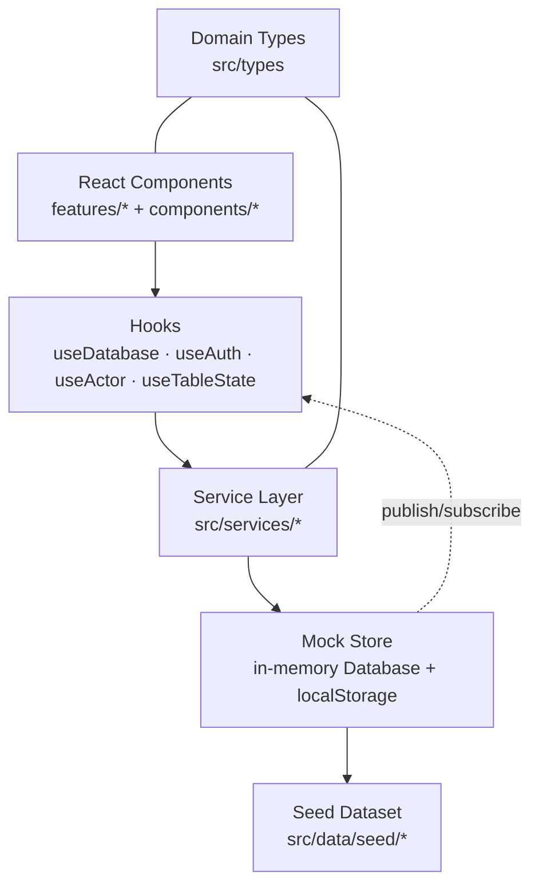

<div align="center">

# Coligo

### Your University, Connected.

A modern, role-based university management system for administrators, department heads, teachers, students, and examination officers — built with React, TypeScript, Vite, and Tailwind CSS.

[](https://react.dev)
[](https://www.typescriptlang.org)
[](https://vitejs.dev)
[](https://tailwindcss.com)
[](#-license)
[](#-contributing)

[Preview Demo]((https://coligo-ums.vercel.app/)) · [Features](#-features) · [Tech Stack](#-tech-stack) · [Getting Started](#-getting-started) · [Demo Accounts](#-demo-accounts) · [Architecture](#-architecture) · [Roadmap](#-roadmap) · [Contributing](#-contributing)

</div>

---

## 📖 Overview

**Coligo** is a frontend-complete university management system that demonstrates how an academic institution can run its day-to-day operations from a single, cohesive platform. It ships with **five dedicated portals**, a realistic seed dataset, and a service layer that is ready to be swapped for a real Express + PostgreSQL backend without rewriting a single page.

The project focuses on three things:

1. **A coherent product** — every route, button, form, and table works. There are no dead ends or "coming soon" screens.
2. **Realistic academic workflows** — weighted assessments, attendance tracking, result approval → publication, timetable conflict detection, and credit-weighted GPA.
3. **A clean architecture** — typed domain models, isolated services, reusable UI primitives, and role-scoped selectors.

> **Status:** Frontend-only reference implementation. Data is generated deterministically and persisted to `localStorage`. Authentication is simulated for demonstration purposes.

---

## ✨ Features

### Five role-based portals

| Portal | What it covers |
| --- | --- |
| 🛡️ **Administrator** | Institution-wide dashboard, departments, courses, academic sessions & semesters, timetable, students, teachers, user accounts, course offerings & enrollments, announcements, reports, audit logs, and system settings. |
| 🏛️ **Head of Department** | Department overview, students, teachers, courses, offerings, attendance monitoring, academic performance, and departmental reports — all scoped to their own department. |
| 👨‍🏫 **Teacher** | Assigned courses, enrolled students, attendance marking, assessment creation, marks entry, and a personal weekly timetable. |
| 🎓 **Student** | Personal dashboard, profile, enrolled courses, attendance history, published results, and timetable. |
| 📋 **Examination Officer** | Exam scheduling, assessment review, marks-review pipeline, result approval & publication, and examination reports. |

### Platform capabilities

- **Authentication & authorization** — simulated login with role-based route guards (`ProtectedRoute`, `RoleGuard`) and per-role navigation.
- **Full CRUD** — create, edit, and delete for departments, courses, sessions, semesters, offerings, students, teachers, users, announcements, timetable entries, and more.
- **Data tables** — search, sorting, multi-filter, pagination, and real CSV export of the rows on screen.
- **Validated forms** — React Hook Form + Zod schemas with inline error messaging.
- **Analytics** — Recharts dashboards and reports (bar, line, pie) with exportable datasets.
- **Academic engine** — weighted assessment totals, configurable grading scale, credit-weighted GPA, attendance thresholds.
- **Workflow integrity** — result state machine (`draft → submitted → under_review → approved → published | returned`), timetable conflict detection, offering capacity limits, and guard rails against destructive actions.
- **Audit trail** — every mutation is recorded with actor, action, entity, and timestamp.
- **Smooth UX** — toast notifications, confirm dialogs, loading skeletons, empty/error states, keyboard shortcuts, responsive layout, and light/dark theme tokens.
- **Accessibility** — semantic tables, labelled controls, focus-visible rings, keyboard-navigable menus, and reduced-motion support.

### Keyboard shortcuts

| Shortcut | Action |
| --- | --- |
| `Ctrl` / `⌘` + `K` | Open global search |
| `Ctrl` / `⌘` + `B` | Collapse / expand the sidebar |

---

## 🧰 Tech Stack

| Layer | Technology |
| --- | --- |
| UI framework | React 18 |
| Language | TypeScript 5 (strict) |
| Build tool | Vite 5 |
| Styling | Tailwind CSS 3.4 + CSS variables (shadcn-style design tokens) |
| Routing | React Router 6 |
| Forms | React Hook Form 7 |
| Validation | Zod 3 + `@hookform/resolvers` |
| Charts | Recharts 2 |
| Primitives | Radix UI |
| Icons | lucide-react |
| Dates | date-fns 3 |
| Notifications | Sonner |
| Utilities | class-variance-authority, clsx, tailwind-merge |

---

## 🚀 Getting Started

### Prerequisites

- **Node.js** 18+ (20 LTS or newer recommended)
- **npm** 9+

### Installation

```bash
git clone https://github.com/aamirali65/coligo-university-management-system.git
cd coligo-university-management-system
npm install
```

> If `esbuild`'s postinstall script is blocked by your package manager, approve it once with `npm approve-scripts esbuild`.

### Run locally

```bash
npm run dev
```

Open **http://localhost:5173** and sign in with one of the [demo accounts](#-demo-accounts).

### Production build

```bash
npm run build     # type-check (tsc -b) + build to dist/
npm run preview   # serve the production build locally
```

### Available scripts

| Command | Description |
| --- | --- |
| `npm run dev` | Start the Vite dev server |
| `npm run build` | Type-check and build for production |
| `npm run preview` | Preview the production build |
| `npm run typecheck` | Run the TypeScript compiler without emitting |
| `npm run lint` | Run ESLint (config included separately) |

---

## 🔑 Demo Accounts

Use the **quick sign-in selector** on the login page, or enter credentials manually.

| Role | Email | Password |
| --- | --- | --- |
| 🛡️ Administrator | `admin@coligo.demo` | `Admin123!` |
| 🏛️ Head of Department | `hod@coligo.demo` | `Hod123!` |
| 👨‍🏫 Teacher | `teacher@coligo.demo` | `Teacher123!` |
| 🎓 Student | `student@coligo.demo` | `Student123!` |
| 📋 Examination Officer | `exams@coligo.demo` | `Exams123!` |

> Passwords are validated **in memory only** and are never written to `localStorage`.

---

## 🏗️ Architecture

Coligo is organized around a small number of clear layers, so features stay predictable and the mock backend can be replaced without touching the UI.



### Key ideas

- **Single source of truth.** One `Database` object holds every entity. It is hydrated from the deterministic seed on first run, persisted to `localStorage` (`coligo:db`), and exposed to React through `useSyncExternalStore`.
- **Mutations are services, reads are selectors.** Every write goes through a typed service that validates input, commits a deep clone, appends an audit entry, and notifies subscribers. Selectors accept the database and return derived data.
- **Role scoping lives in the data layer.** For example, students only ever receive results with `status === "published"`, and HOD/teacher/student views filter by their linked department, teacher, or student record.
- **UI is dumb about persistence.** Pages consume hooks and services; they never touch `localStorage` directly.

For a deeper dive, see [`docs/architecture.md`](docs/architecture.md) and [`docs/roles-and-permissions.md`](docs/roles-and-permissions.md).

### Data flow at a glance

```
User action → Zod-validated form → Service mutation
     → validate + commit (deep clone) → audit log → notify subscribers
     → useDatabase re-renders → selectors recompute → UI updates
```

### Grading model

Course totals are the weighted sum of assessment marks:

```
total% = Σ (score / maxMarks × weight)
```

The percentage maps to a letter grade and grade point via a configurable scale (A = 4.0 … F = 0.0). GPA is the credit-weighted average of published course grade points:

```
GPA = Σ (gradePoint × creditHours) / Σ creditHours
```

The scale can be edited in **Settings → Grading scale** and is documented in [`src/lib/constants.ts`](src/lib/constants.ts).

---

## 📁 Project Structure

```
coligo/
├── public/                     Static assets (favicon)
├── src/
│   ├── app/                    App shell, router, providers, error boundary
│   ├── components/
│   │   ├── ui/                 Design-system primitives (button, dialog, table, …)
│   │   ├── shared/             Composed components (page header, stat card, …)
│   │   ├── tables/             DataTable, toolbar, filters, pagination
│   │   ├── forms/              Field wrappers + form dialog
│   │   ├── charts/             Chart card wrapper
│   │   └── layout/             Sidebar, header, app layout
│   ├── data/seed/              Deterministic seed dataset
│   ├── features/               Domain + role feature modules
│   │   ├── auth/ dashboard/ departments/ users/ students/ teachers/
│   │   ├── courses/ academics/ enrollments/ timetable/ reports/ audit/
│   │   ├── settings/ announcements/ profile/
│   │   └── hod/ teacher/ student/ examinations/
│   ├── hooks/                  useDatabase, useActor, useTableState
│   ├── lib/                    Constants, formatting, grading, CSV, navigation, utils
│   ├── services/               Service layer (interfaces + mock implementation)
│   │   └── mock/               In-memory store + query helpers
│   ├── styles/                 Tailwind entry + CSS variables
│   └── types/                  Shared domain types
├── docs/                       Architecture and role documentation
├── index.html
├── tailwind.config.js
├── tsconfig.json
└── vite.config.ts
```

### Core routes

| Prefix | Audience |
| --- | --- |
| `/` · `/login` | Public landing and authentication |
| `/admin/*` | Administrator |
| `/hod/*` | Head of Department |
| `/teacher/*` | Teacher |
| `/student/*` | Student |
| `/examinations/*` | Examination Officer |

### Services

| Service | Responsibility |
| --- | --- |
| `authService` | Session lifecycle and demo credential validation |
| `departmentService` / `userService` | Organizational structure and accounts |
| `studentService` / `teacherService` | People records, attendance and result roll-ups |
| `courseService` / `academicService` | Catalogue, sessions, semesters, offerings |
| `enrollmentService` | Enrollment lifecycle and capacity checks |
| `attendanceService` | Class sessions, attendance capture, summaries |
| `assessmentService` / `marksService` | Assessment definitions and marks entry |
| `examinationService` | Exam scheduling and conflict detection |
| `resultService` | Weighted totals and the result approval workflow |
| `timetableService` | Weekly scheduling with room/teacher conflict rules |
| `announcementService` | Audience-scoped announcements |
| `reportService` | Aggregations for dashboards and reports |
| `auditService` | Audit trail queries |
| `settingsService` | Institution settings, grading scale, demo reset |

---

## 🎨 Design System

- **Colour language** — deep navy and trust-building blue on clean white, with semantic success/warning/destructive tokens. Every colour is defined as an HSL CSS variable so light/dark themes stay consistent.
- **Typography** — Inter, with a tight heading scale and readable body text.
- **Spacing & radii** — an 8px rhythm, 12–16px card radii, and restrained shadows.
- **Components** — 20+ primitives (button, input, dialog, dropdown, tabs, tooltip, table, badge, progress, skeleton, …) composed into shared patterns like `PageHeader`, `StatCard`, `DataTable`, and `FormDialog`.
- **States** — every list supports loading skeletons, empty states, error states, and filter-aware messaging.

---

## 🔒 Security Notes & Limitations

Coligo is a **demonstration frontend**, not a production deployment. In particular:

- There is **no backend**. All data lives in the browser and can be inspected or cleared by the user.
- **Authentication is simulated.** Demo passwords are checked in memory and are not persisted; there is no hashing, token issuance, or server-side authorization.
- **Role checks are client-side.** They demonstrate UX and routing behavior, not security boundaries.
- **`localStorage` is not a database.** Clearing site data resets the application to its seed state (or use **Settings → Reset demo data**).
- **No automated tests yet.** Verification is currently `tsc` type-checking plus the production build.

When the real backend is added, the service layer should be replaced by API clients, authorization must be enforced server-side, and secrets must never reach the client.

---

## 🗺️ Roadmap

- [ ] Express + PostgreSQL backend with REST/JSON APIs
- [ ] Real authentication (JWT/session) with hashed passwords and server-side RBAC
- [ ] Automated tests (Vitest + React Testing Library) and CI
- [ ] Route-level code-splitting to reduce the initial bundle
- [ ] File uploads (course materials, student documents)
- [ ] Email/SMS notifications and calendar exports (`.ics`)
- [ ] Internationalization and multi-campus support
- [ ] Dark-mode toggle persisted per user

---

## 🤝 Contributing

Contributions, issues, and feature requests are welcome.

1. Fork the repository.
2. Create a feature branch: `git checkout -b feature/your-feature`.
3. Commit your changes with a clear message.
4. Push the branch and open a pull request describing the change and its motivation.

Please keep the existing conventions: strict TypeScript, `@/` path imports, Zod-validated forms, and services for all data mutations.

---

## 📄 License

Released under the [MIT License](LICENSE).

---

<div align="center">

**Coligo** — built to make university operations feel connected.

⭐ If you find this project useful, consider giving it a star.

</div>
