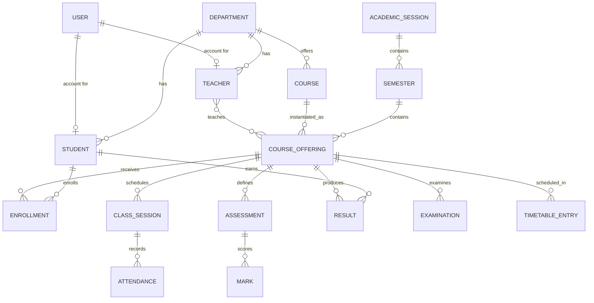

# Architecture

This document explains how Coligo is put together, why it is structured this way, and how to extend it or swap the mock backend for a real API.

---

## 1. Goals

The application is organized around four constraints:

1. **Type safety end to end.** Domain models live in one place and are shared by services, hooks, and components.
2. **A replaceable backend.** Pages never talk to storage directly; they call services. Replacing the mock layer should not require touching UI code.
3. **Predictable state.** A single in-memory database with subscriptions avoids scattered local caches and stale views.
4. **Role-scoped data.** Authorization-like filtering is expressed in selectors so a student, teacher, or HOD can reuse the same components without leaking data.

---

## 2. Layers

```
┌──────────────────────────────────────────────────────────────┐
│  Features (pages)          src/features/**                    │
│  Compose layout, shared components, hooks and services.       │
└───────────────┬──────────────────────────────────────────────┘
                │ hooks
┌───────────────▼──────────────────────────────────────────────┐
│  Hooks                     src/hooks/**                       │
│  useDatabase · useAuth · useActor · useTableState             │
└───────────────┬──────────────────────────────────────────────┘
                │ calls
┌───────────────▼──────────────────────────────────────────────┐
│  Services                  src/services/**                    │
│  Selectors (db → data) and mutations (input, actor).          │
└───────────────┬──────────────────────────────────────────────┘
                │ reads / commits
┌───────────────▼──────────────────────────────────────────────┐
│  Mock store                src/services/mock/store.ts         │
│  Database + localStorage + subscribe/notify + audit.          │
└───────────────┬──────────────────────────────────────────────┘
                │ hydrates from
┌───────────────▼──────────────────────────────────────────────┐
│  Seed data                 src/data/seed/**                   │
│  Deterministic dataset built by buildSeedDatabase().          │
└──────────────────────────────────────────────────────────────┘
```

### Feature modules

Each module owns the pages for one domain or role (`departments`, `students`, `teacher`, `examinations`, …). A page:

- reads the database with `useDatabase()` (or `useAuth()` for the current user);
- calls service selectors for derived data;
- calls service mutations from event handlers;
- reports outcomes with `notify` and asks for confirmation with `ConfirmDialog`.

Pages do not import the store or touch `localStorage`.

### Hooks

| Hook | Purpose |
| --- | --- |
| `useDatabase()` | Subscribes to the mock store via `useSyncExternalStore` and returns the current `Database`. |
| `useAuth()` | Returns the current session, resolved `User`, role, `login` and `logout`. |
| `useActor()` | Converts the current user into an `Actor { id, name }` for audit trails. |
| `useTableState()` | Owns search, sort, filters, page, and page size, and derives `ListParams`. |

### Services

Services are plain objects with two kinds of methods:

```ts
// Selector: pure, synchronous, takes the database.
studentService.list(db, params): Paginated<Student>

// Mutation: asynchronous, validates, commits, audits.
studentService.create(input, actor): Promise<Student>
```

`ListParams` standardizes querying:

```ts
interface ListParams {
  search?: string;
  page?: number;
  pageSize?: number;
  sortBy?: string;
  sortDir?: "asc" | "desc";
  filters?: Record<string, string | undefined>;
}
```

All list selectors return `Paginated<T>`, which lets tables and pagination share one contract.

---

## 3. The mock store

`src/services/mock/store.ts` is the heart of the frontend data layer.

- **Hydration.** On first import, the store reads `localStorage["coligo:db"]`. If it is missing, malformed, or has a different `schemaVersion`, it builds a fresh database from the seed.
- **Commit.** A mutation calls `commit(mutator, auditEntry)`. `commit` deep-clones the database, applies the mutator to the draft, stamps an audit log entry, persists the result, and notifies subscribers.
- **Subscription.** `subscribe(listener)` is consumed by `useSyncExternalStore`, so any committed change re-renders every interested component.
- **Reset.** `resetDatabase()` rebuilds the seed; `settingsService.resetDemoData()` uses it to restore the demo.

Because the store clones before mutating, selectors can safely hold references to objects from the previous snapshot.

### Why a single store?

- No cache invalidation problems between pages.
- Cross-module consistency (e.g. enrolling a student immediately changes dashboard counts).
- Easy to replace: the store is the only place that knows about persistence.

---

## 4. Domain model

All entities are declared in [`src/types/index.ts`](../src/types/index.ts). The main relationships:



A few important invariants:

- An assessment's weights for one offering must not exceed **100**.
- An offering cannot exceed its **capacity**.
- Timetable entries cannot overlap for the same **teacher** or **room** on the same day.
- A result can only move forward through its state machine (see below).
- Students can only see results with status `published`.

---

## 5. Result workflow

```
draft ──submitOffering──▶ submitted ──decide──▶ under_review ──decide──▶ approved ──decide──▶ published
                                     │                    │
                                     └──── decide ────────┴──▶ returned ──submitOffering──▶ submitted
```

- `resultService.computeTotal(db, offeringId, studentId)` recalculates the weighted total, letter grade, and grade point from marks and the configured grading scale.
- `submitOffering` recalculates totals and moves drafts (and returned results) to `submitted`.
- `decide` / `decideOffering` enforce valid transitions and stamp `reviewedAt`, `approvedAt`, or `publishedAt`.
- Every transition appends to `result.history` with the actor and timestamp.

---

## 6. Grading

Implemented in [`src/lib/grading.ts`](../src/lib/grading.ts):

```ts
weightedTotal(entries) // Σ (earned / max × weight), returns null if no usable weights
gradeForPercent(total, scale) // { grade, points, band }
calculateGpa(courses) // credit-weighted GPA, ignores pending grades
```

The default scale lives in `DEFAULT_GRADING_SCALE` and can be edited at runtime in **Settings**. Always read the scale from `db.settings.gradingScale` rather than hardcoding bands.

---

## 7. Routing and authorization

- `src/app/router.tsx` defines public routes and nested protected routes.
- `ProtectedRoute` redirects unauthenticated users to `/login`, preserving the intended path.
- `RoleGuard` restricts a route subtree to a set of roles and redirects others to `/unauthorized`.
- `AppLayout` provides the sidebar, header, breadcrumbs, notifications, and mobile navigation.

Role checks here are a UX demonstration. In production, the server must enforce authorization for every request.

---

## 8. Design system

- Tokens are HSL CSS variables in `src/styles/globals.css`, consumed by `tailwind.config.js`.
- Primitives in `src/components/ui` follow a shadcn-style pattern: Radix behavior + Tailwind styling + `cva` variants.
- `cn()` merges conditional classes with `tailwind-merge`.
- Shared patterns (`PageHeader`, `StatCard`, `DataTable`, `FormDialog`, `EmptyState`, `ConfirmDialog`) keep pages visually and behaviorally consistent.

---

## 9. Extending Coligo

### Add a new entity

1. Add the interface to `src/types/index.ts` and a field on `Database`.
2. Create seed data and register it in `src/data/seed/index.ts`.
3. Write a service in `src/services/` with selectors and mutations (use `commit` and `AppError`).
4. Build the page in `src/features/`, composing `DataTable`, `FormDialog`, and shared components.
5. Register the route in `src/app/router.tsx` and, if needed, a nav item in `src/lib/navigation.ts`.

### Swap in a real backend

1. Keep the service method signatures and return types.
2. Replace selectors with API calls that return the same `Paginated<T>` / entity shapes.
3. Replace mutations with `fetch`/`axios` requests and optimistic updates if desired.
4. Delete `src/services/mock` and `src/data/seed`, and route `useDatabase` through a query cache (e.g. React Query).
5. Move validation and authorization enforcement to the server; keep Zod for client-side UX.
